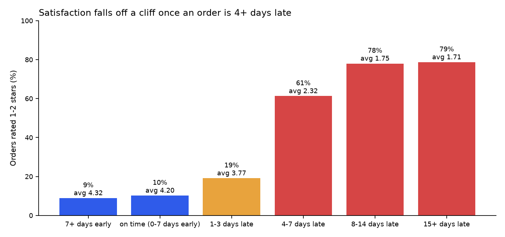
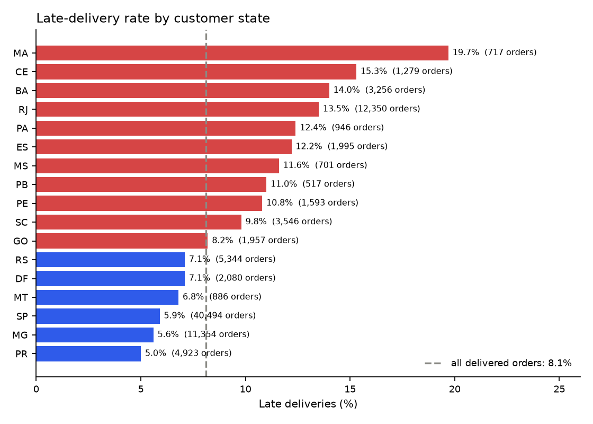
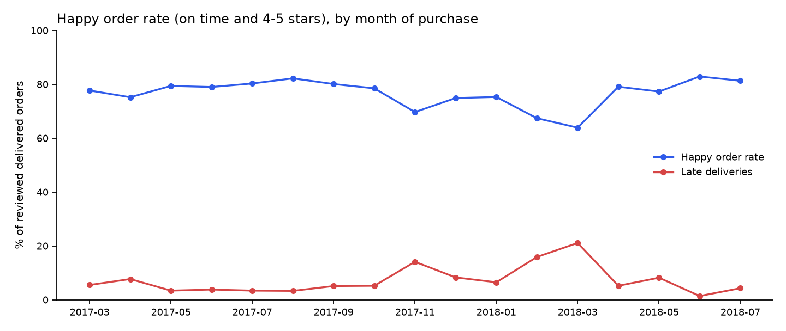

# Olist marketplace: a product analytics case study

**Question:** why do customers leave bad reviews on a Brazilian online marketplace, and what should the product team fix first?

I analysed about 100,000 real orders (2016 to 2018) from [Olist](https://www.kaggle.com/datasets/olistbr/brazilian-ecommerce) using SQL (DuckDB) and Python, then turned the findings into a north-star metric, prioritised recommendations, and an experiment plan with sample sizes.

## The answer in one paragraph

Late delivery is the biggest fixable driver of unhappy customers. Only about 8% of orders arrive after the promised date, but those orders produce **34% of all 1-2 star reviews**. Satisfaction does not decline gently: it **falls off a cliff once an order is 4 or more days late** (61 to 79% of those orders get 1-2 stars, versus 19% at 1 to 3 days late). The delay builds up in the **carrier leg, not at the seller**, and it is concentrated in a few large states (Rio de Janeiro, Bahia, Ceará, Maranhão). Separately, **97% of customers never order a second time**, and the data does not show that lateness is the cause, so retention needs its own investigation.

## Key findings

| # | Finding | Evidence |
|---|---|---|
| 1 | Growth has flattened | Orders peaked at 7,421 in Nov 2017 and have stayed between 6,145 and 7,187 per month in Jan to Aug 2018. |
| 2 | Late orders are rare but cause a third of bad reviews | 8.0% of delivered orders are late, but 33.8% of 1-2 star reviews follow a late delivery. Average review: 4.29 on time vs 2.57 late. |
| 3 | There is a cliff at 4+ days late | 1-2 star share: 9% (7+ days early), 10% (on time), 19% (1-3 days late), 61% (4-7), 78% (8-14), 79% (15+). |
| 4 | Lateness happens in transit | Late orders spend a median 23.9 days with the carrier, vs 6.9 for on-time orders. The seller missed the handoff deadline in 27.2% of late orders (7.4% of on-time ones). |
| 5 | A few large states are the problem | Late rate: MA 19.7%, CE 15.3%, BA 14.0%, RJ 13.5% (12,350 orders) vs SP 5.9% and PR 5.0%. |
| 6 | Delivery promises are padded | On-time orders arrive in a median 9.7 days but were promised in 23.3. 74% of reviewed orders arrive 7+ days early. |
| 7 | Bad sellers are not the main cause | The worst 10% of sellers (by late rate) are 19.0% late vs 7.3% for the rest, but account for only 14.3% of all late orders. |
| 8 | Repeat purchase is very low | 96.96% of customers placed one order. Repeat within 180 days: 3.18% (first order on time) vs 2.72% (late), a difference that is **not** statistically significant (p = 0.11). |
| 9 | Sales depend on few sellers | The top 10% of sellers bring in 67.6% of GMV. |





## North-star metric

**Happy order rate:** the share of delivered orders that arrived on or before the promised date **and** received 4 or 5 stars.

It ranged from 63.9% (Mar 2018) to 82.9% (Jun 2018) and moves closely with the late rate (21.1% late in Mar 2018, 1.4% in Jun 2018). I chose it because it combines what the operations team controls (on-time delivery) with what the customer actually feels (the rating). Guardrails to watch alongside it: cancellation rate (0.63% of orders), average order value (about R$ 126 to 145 in 2018), and GMV.



Caveat: reviews arrive after delivery, so this metric lags. A leading indicator would be the share of in-transit orders predicted to miss the promised date.

## Recommendations, in priority order

| # | Recommendation | Why | Upper-bound impact (from the data) | How to test it |
|---|---|---|---|---|
| 1 | **Stop orders from crossing the 4-day-late line.** Detect at-risk orders in transit, tell the customer early with a revised date, and offer a small credit when the delay will pass 3 days. | The cliff in finding 3: the damage is concentrated past 3 days. | Halving late deliveries (8.0% to 4.0%) would lift the average review from 4.16 to 4.23 and cut 1-2 star reviews by 14% (12.8% to 11.0%). | Randomise orders in the worst states; judge on happy order rate. About 14,270 orders in total, roughly 2 months at 2018 volume. |
| 2 | **Fix the carrier leg in MA, CE, BA and RJ.** Review carrier performance by lane and test alternatives. | Transit time is where late orders lose their days (finding 4), and late rates in these states are roughly 2 to 4 times those of the best states. | Same pool as above. This is the lever that removes lateness rather than managing it. | Carrier pilot on one lane, measure late rate and happy order rate. |
| 3 | **Set promise dates by state.** Tighten the padded promise where late rates are low (SP, MG, PR) and widen it where they are high. | Median promise is 23.3 days vs 9.7 delivered (finding 6). | Not sizeable here: the data has no traffic or conversion events, so the effect on checkout conversion is unknown. | A/B test the displayed delivery date. Primary metric: conversion. Guardrail: late rate. |
| 4 | **Add seller handoff alerts.** | Sellers missed the handoff deadline in 27.2% of late orders (finding 4). | Limited: the worst 10% of sellers account for 14.3% of late orders (finding 7). | Alert sellers 24 hours before the deadline; compare missed-deadline rates. |
| 5 | **Treat retention as a separate research project.** | 97% buy once, and lateness does not explain it (finding 8). | Not sized. | Customer interviews and a post-purchase survey first, then test a re-engagement message. |

Priority reasoning: recommendations 1 and 2 are the largest measured effect with the clearest mechanism. Recommendation 3 may matter most commercially but cannot be sized from this data, so it comes after a plan to collect conversion data.

### Experiment sizing

Calculated in [`analysis/sizing.py`](analysis/sizing.py) (80% power, 5% significance, two-sided):

| Experiment | Baseline | Detectable change | Orders per arm | Time at 2018 volume |
|---|---:|---:|---:|---:|
| Proactive delay message, judged on late orders only (1-2 star rate) | 54.0% | -5 points | 1,568 | about 6 months |
| Delivery change on all orders, judged on happy order rate | 75.1% | +2 points | 7,135 | about 2.1 months |

Testing only on late orders is too slow (only about 8% of orders are late), so the plan randomises all orders in the affected states and judges them on the happy order rate. Full details: [`results/sizing.md`](results/sizing.md).

## Other observations

- **Payments:** 75.4% of orders are paid by credit card, and 68.0% of those use installments. 19.9% use boleto (bank slip).
- **Freight burden:** furniture and home categories carry the highest shipping cost relative to item price (office furniture 25.0%, furniture decor 23.7%, housewares 23.1%), and office furniture has the lowest average review among the top 15 categories (3.49).
- **Seller concentration** and **growth** charts: [`charts/05_seller_concentration.png`](charts/05_seller_concentration.png), [`charts/01_growth.png`](charts/01_growth.png).

## Method

- **Data:** Olist Brazilian E-Commerce Public Dataset, 99,441 orders from Sep 2016 to Oct 2018, across orders, items, payments, reviews, customers, products and sellers tables.
- **Tools:** SQL on DuckDB (14 queries, one question each in [`sql/`](sql/)), Python, pandas, matplotlib.
- **Definitions:** *late* = delivered after the estimated delivery date shown to the customer. *GMV* = item price, excluding freight. *Repeat purchase* uses the customer's unique ID, since the same person gets a new customer ID on each order. Orders with several reviews use the average review.
- **Scope choices:** growth and north-star charts use complete months only, because Sep 2016 to Dec 2016 and Sep to Oct 2018 are very sparse. The repeat-purchase test uses only customers whose first order was by 28 Feb 2018, so every customer had a full 180 days to return.

### Limitations

- This is observational data. Late orders may also differ in other ways (distance, item size), so the impact numbers are upper bounds, not proven effects.
- There is no traffic, cart or conversion data, so checkout effects cannot be measured.
- The carrier is not identified, so "carrier problem" means the delay occurs after the seller hands the parcel over, not which carrier is responsible.
- I do not know why late deliveries spiked in Nov 2017 and Feb to Mar 2018. The data shows that they did, not why.
- Reviews are voluntary, and this is one marketplace in one country.

## Reproduce

Requires [uv](https://docs.astral.sh/uv/).

```bash
uv sync
uv run python analysis/download_data.py   # downloads the CSVs into data/ (not stored in this repo)
uv run python analysis/run.py             # runs every SQL file, writes results/*.csv
uv run python analysis/charts.py          # writes charts/*.png
uv run python analysis/sizing.py          # writes results/sizing.md
```

## Data and license

The dataset is published by Olist under [CC BY-NC-SA 4.0](https://creativecommons.org/licenses/by-nc-sa/4.0/); the raw files are not included here. The result tables are aggregates derived from it, so they carry the same terms. The code is MIT licensed (see [LICENSE](LICENSE)).
